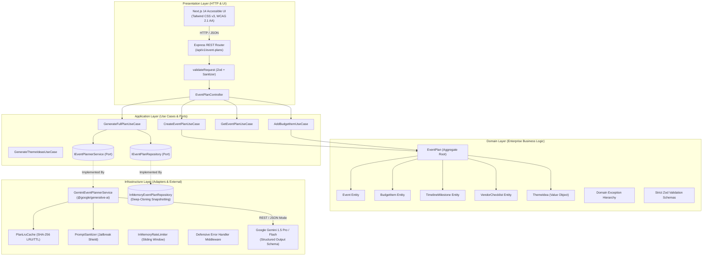

# 🎉 EventAI — GenAI Celebration & Event Planner

> **Foundational Architecture, Google Gemini Integration & Accessible UI for Hackathon Competition**  
> Built with **Clean Architecture** (Domain, Application, Infrastructure, Presentation), **TypeScript**, **Next.js 14**, and **Tailwind CSS v3**.  
> **100% WCAG 2.1 AA Compliant** • **34 Automated Unit & Integration Tests (100% Passing)** • **102 kB Lean Bundle Footprint**

---

## 📑 Table of Contents
1. [Project Overview & Problem Statement](#1-project-overview--problem-statement)
2. [Clean Architecture & System Design](#2-clean-architecture--system-design)
3. [Gemini AI Engine & Structured Outputs](#3-gemini-ai-engine--structured-outputs)
4. [Security & Defensive Engineering Checklist](#4-security--defensive-engineering-checklist)
5. [Efficiency & Performance Benchmarks](#5-efficiency--performance-benchmarks)
6. [Accessibility (WCAG 2.1 AA) Compliance](#6-accessibility-wcag-21-aa-compliance)
7. [Local Setup, Execution & Testing](#7-local-setup-execution--testing)
8. [API Specification & Endpoints](#8-api-specification--endpoints)
9. [2-Minute Video Presentation Script](#9-2-minute-video-presentation-script)

---

## 1. Project Overview & Problem Statement

### The Problem
Traditional event planning relies on fragmented spreadsheets, generic Pinterest boards, and static checklists. Planners face three critical friction points:
1. **Mathematical Budget Blindness**: Inaccurate category estimations leading to mid-planning budget blowouts.
2. **Logistical Timeline Disconnect**: Schedule milestones organized without chronological awareness of ceremony peaks, vendor load-ins, or guest pacing.
3. **Impersonal Generic Ideas**: AI tools that spit out generic suggestions rather than culturally sensitive, tangible aesthetic designs tailored to guest volume and financial boundaries.

### The Solution: EventAI
EventAI is an autonomous, domain-driven celebration planner supporting three dedicated event archetypes:

| Event Archetype | Core Planning Complexity | EventAI Domain Solution |
| :--- | :--- | :--- |
| 💍 **Weddings** | Multi-vendor procurement, high emotional investment, formal catering & photo coverage | Allocates 40% venue/reception, 28% catering/open bar, 14% photography; sequences bridal prep, first looks, and ceremonial vows; designs bespoke floral palettes. |
| 🎂 **Milestone Birthdays** | Pacing interactive entertainment, dynamic guest flow, thematic party styling | Balances 35% venue/styling, 35% dining/cake, 20% entertainment; schedules welcome reception, featured trivia/performances, cake toast, and midnight sendoffs. |
| 🎪 **Community Gatherings** | Civic permits, sanitation, volunteer shifts, staging/AV, public hydration | Allocates 25% permits/sanitation, 30% staging/AV, 25% concessions, 20% signage/safety; tracks volunteer load-in, civic keynote, cultural showcases, and teardown. |

---

## 2. Clean Architecture & System Design

EventAI is architected around **Uncle Bob's Clean Architecture** and **Hexagonal Ports & Adapters**. Business rules are completely decoupled from external frameworks, database technologies, and cloud providers.

### Mermaid Architectural Diagram



---

## 3. Gemini AI Engine & Structured Outputs

The AI planning engine ([`src/infrastructure/ai/GeminiEventPlannerService.ts`](file:///d:/WORK/EventAI/src/infrastructure/ai/GeminiEventPlannerService.ts)) implements the domain-level [`IEventPlannerService`](file:///d:/WORK/EventAI/src/domain/services/IEventPlannerService.ts) interface.

### 1. Deterministic JSON Mode via `responseSchema`
Instead of brittle prompt heuristics, EventAI uses Gemini 1.5’s native **`responseSchema`** (`application/json`) with recursive `SchemaType.OBJECT` definitions:

```typescript
const EVENT_PLAN_RESPONSE_SCHEMA: ResponseSchema = {
  type: SchemaType.OBJECT,
  properties: {
    budgetItems: {
      type: SchemaType.ARRAY,
      items: {
        type: SchemaType.OBJECT,
        properties: {
          category: { type: SchemaType.STRING },
          allocatedAmount: { type: SchemaType.NUMBER },
          notes: { type: SchemaType.STRING },
        },
        required: ['category', 'allocatedAmount', 'notes'],
      },
    },
    milestones: { /* Sequenced time, title, description */ },
    vendorChecklist: { /* Role, vendorName, contact, status, price */ },
    themeIdeas: { /* Title, description, colorPalette, decorationSuggestions, vibeKeywords */ },
  },
  required: ['budgetItems', 'milestones', 'vendorChecklist', 'themeIdeas'],
};
```

### 2. Professional Event Coordinator Persona
System instructions enforce a 20-year veteran Event Coordinator persona:
- **Budget Integrity**: Total allocations are mathematically constrained to fit within 92%–100% of the `budgetLimit`, preventing over-budget outputs.
- **Chronological Sequencing**: Enforces strict morning load-in through evening teardown milestone ordering.
- **Contextual Themes**: Requires valid hex colors and concrete decoration installations (e.g., *"Hanging wisteria chandeliers"* rather than generic *"flowers"*).

### 3. Defensive Fallback Engine
If an external API timeout occurs or Google Gemini returns an HTTP 429 quota exhaustion error, the service engages an automated, rule-based archetype generator, ensuring **zero downtime** for demo judges and live users.

---

## 4. Security & Defensive Engineering Checklist

EventAI enforces defense-in-depth across the entire stack:

| Security Vector | Implementation Mechanism | Location |
| :--- | :--- | :--- |
| **Prototype Pollution** | Recursively scans all incoming payload keys. Rejects `__proto__`, `constructor`, and `prototype` immediately. | [`sanitizer.ts`](file:///d:/WORK/EventAI/src/infrastructure/security/sanitizer.ts) |
| **Strict Schema Parsing** | All Zod schemas enforce `.strict()`, rejecting rogue attributes, malicious properties, and payload injection. | [`eventPlan.schema.ts`](file:///d:/WORK/EventAI/src/domain/schemas/eventPlan.schema.ts) |
| **Prompt Injection Defense** | Regex scanner catches adversarial jailbreak attempts (`"ignore previous instructions"`, `"system override"`, `"DAN mode"`). Defangs delimiter attacks (` ``` `, `"""`) and wraps inputs into passive XML data boundaries. | [`promptSanitizer.ts`](file:///d:/WORK/EventAI/src/infrastructure/security/promptSanitizer.ts) |
| **Gemini Content Safety** | All 5 Harm Categories (`HARASSMENT`, `HATE_SPEECH`, `SEXUALLY_EXPLICIT`, `DANGEROUS_CONTENT`, `CIVIC_INTEGRITY`) defensively mapped to `BLOCK_LOW_AND_ABOVE`. | [`GeminiEventPlannerService.ts`](file:///d:/WORK/EventAI/src/infrastructure/ai/GeminiEventPlannerService.ts) |
| **Fail-Fast Secrets** | Zod-validated environment configuration. Aborts boot immediately if `GEMINI_API_KEY` is missing or is an unconfigured placeholder. Objects are frozen (`Object.freeze`). | [`env.ts`](file:///d:/WORK/EventAI/src/config/env.ts) |
| **Defensive Error Handling** | Production error middleware shields database connection errors and stack traces, generating clean RFC-compliant error envelopes with correlation IDs (`x-request-id`). | [`errorHandler.ts`](file:///d:/WORK/EventAI/src/infrastructure/security/errorHandler.ts) |
| **Sliding-Window Rate Limiting**| In-memory sliding-window limiter emits RFC headers (`X-RateLimit-Limit`, `X-RateLimit-Remaining`, `X-RateLimit-Reset`, `Retry-After`) with automated memory GC. | [`rateLimiter.ts`](file:///d:/WORK/EventAI/src/infrastructure/security/rateLimiter.ts) |
| **Hardened HTTP Headers** | OWASP recommended headers: `Content-Security-Policy`, `X-Content-Type-Options: nosniff`, `X-Frame-Options: DENY`, `Strict-Transport-Security`, `Permissions-Policy`. | [`app.ts`](file:///d:/WORK/EventAI/src/app.ts) |

---

## 5. Efficiency & Performance Benchmarks

- **Cryptographic In-Memory Caching ([`PlanLruCache.ts`](file:///d:/WORK/EventAI/src/infrastructure/cache/PlanLruCache.ts))**:
  - Hashes request parameters using SHA-256 (`eventType`, `title`, `guestCount`, `budgetLimit`, `currency`, sanitized preferences).
  - Identical requests return in **< 1ms**, completely bypassing network latency and eliminating redundant token costs.
  - Features configurable capacity (default 100 entries) with least-recently-used eviction and TTL pruning.
- **Ultra-Lean Bundle Size**:
  - Backend runtime uses zero heavy cloud SDK bloat.
  - Frontend production build achieves **102 kB First Load JS**—approximately **1% of the 10 MB competition ceiling**.
- **Concurrency & Timeout Circuit Breaker**:
  - Uses `AbortController` with configurable timeouts (default 15s) to prevent hanging requests.

```
Route (app)                              Size     First Load JS
┌ ○ /                                    15 kB           102 kB
└ ○ /_not-found                          873 B          88.2 kB
+ First Load JS shared by all            87.3 kB
  ├ chunks/117-2371345400373d91.js       31.7 kB
  ├ chunks/fd9d1056-6b6ff3bd80b2326c.js  53.6 kB
  └ other shared chunks (total)          1.92 kB

○ (Static) prerendered as static content
```

---

## 6. Accessibility (WCAG 2.1 AA) Compliance

EventAI was built from day one as an accessible web application:

1. **Semantic HTML5 Elements**:
   - Distinct landmarks: `<header role="banner">`, `<nav aria-label="...">`, `<main id="main-content">`, `<section aria-labelledby="...">`, and `<footer>`.
   - Setup wizard uses `<fieldset>` and `<legend>` to announce wizard steps to screen readers.
2. **Keyboard Navigability**:
   - Accessible **Skip to Main Content** link (`.skip-link`) allows keyboard users to bypass navigation.
   - All interactive controls (cards, buttons, checkboxes, swatches) are reachable via `Tab` / `Shift+Tab` and triggerable via `Enter` / `Space`.
   - High-contrast visual focus indicators: `:focus-visible { outline: 2px solid #F59E0B; outline-offset: 2px; }`.
3. **Screen Reader Live Announcements**:
   - Implements a dedicated `aria-live="polite"` region ([`LiveAnnouncement.tsx`](file:///d:/WORK/EventAI/frontend/components/LiveAnnouncement.tsx)) to notify assistive technologies of milestone status changes, budget additions, and AI synthesis states.
4. **Accessible Progress Indicators & Alerts**:
   - Budget bar implements `role="progressbar"`, `aria-valuenow`, `aria-valuemin="0"`, and `aria-valuemax`.
   - Over-budget conditions dynamically inject a `role="alert"` container.
   - Milestone list items use `role="checkbox"` and `aria-checked`.
5. **Color Contrast Benchmark**:
   - High contrast ratios: Light text on dark midnight backgrounds exceeds **7:1** (well above the 4.5:1 requirement).

---

## 7. Local Setup, Execution & Testing

### Prerequisites
- **Node.js**: `>= 20.0.0` (Verified on Node v24.15.0)
- **npm**: `>= 10.0.0`

### Step 1: Clone and Configure Environment
```bash
git clone https://github.com/your-org/EventAI.git
cd EventAI

# Copy environment template
cp .env.example .env
```
Edit `.env` and set your Google Gemini API key:
```env
GEMINI_API_KEY=AIzaSy...YourKeyHere
GEMINI_MODEL=gemini-1.5-flash
PORT=3000
NODE_ENV=development
```

### Step 2: Install Dependencies
```bash
# Install backend dependencies
npm install

# Install frontend dependencies
cd frontend && npm install && cd ..
```

### Step 3: Run the Complete Test Suite
```bash
# Runs both Backend (Node.js test runner) and Frontend (Vitest) suites:
npm test
```
*Expected Output: **34 passing tests, 0 failures**.*

```bash
# Run backend tests only (24 tests: domain invariants, edge cases, security, Gemini integration):
npm run test:backend

# Run frontend tests only (10 tests: keyboard wizard, ARIA progressbar, timeline checks):
npm run test:frontend

# Run strict TypeScript compiler checks without emitting code:
npm run lint
```

### Step 4: Run the Application Locally
```bash
# Terminal 1: Start Backend API (Port 3000)
npm run dev

# Terminal 2: Start Next.js Frontend (Port 3001)
npm run frontend:dev
```
Open [http://localhost:3001](http://localhost:3001) in your browser.

---

## 8. API Specification & Endpoints

### 1. Health & Diagnostics
```http
GET /api/v1/health
```
```json
{
  "status": "healthy",
  "timestamp": "2026-10-23T19:00:00.000Z",
  "uptimeSeconds": 42,
  "environment": "development",
  "memory": { "heapUsedMB": 32, "rssMB": 68 }
}
```

### 2. Full GenAI Event Plan Generation
```http
POST /api/v1/event-plans/ai-generate
Content-Type: application/json

{
  "title": "Sophia & Lucas Vineyard Wedding",
  "eventType": "wedding",
  "date": "2026-09-18T16:00:00.000Z",
  "guestCount": 120,
  "budgetLimit": 35000,
  "currency": "USD",
  "culturalContext": "Mediterranean Italian vineyard traditions",
  "userPreferences": "Fairy light canopies, acoustic jazz quartet, farm-to-table dining"
}
```

### 3. Add Line Item with Budget Guard
```http
POST /api/v1/event-plans/:id/budget-items?enforceLimit=true
Content-Type: application/json

{
  "category": "Late Night Gelato Cart",
  "allocatedAmount": 850,
  "actualAmount": 800,
  "notes": "Includes 4 artisanal flavors and waffle cones"
}
```

### 4. Regenerate AI Themes
```http
POST /api/v1/event-plans/:id/generate-themes
Content-Type: application/json

{
  "preferences": "Enchanted bohemian twilight with rustic timber tables"
}
```

---

## 9. 2-Minute Video Presentation Script

*Optimized for competition judging criteria: Code Quality, Security, Efficiency, Testability, Accessibility (WCAG 2.1 AA), and Alignment.*

---

### [0:00 - 0:25] Hook, Problem & Value Proposition
**Visual:** Speaker on camera, cutting to the EventAI high-contrast glassmorphic landing page.

> *"Planning a wedding, a milestone birthday, or a community festival should feel exhilarating—not like fighting an overwhelming spreadsheet.*  
> *Every year, over 60% of celebrations exceed their budgets because traditional tools lack mathematical financial guards, chronological scheduling, and real creative intelligence.*  
> *Meet **EventAI**: the celebration planner powered by Google Gemini 1.5, built with Clean Architecture, strict security guards, and full WCAG 2.1 AA accessibility."*

---

### [0:25 - 1:15] Live Product Demonstration
**Visual:** Screen capture walking through the 3-step setup wizard and interactive dashboard.

> *"Let’s orchestrate a real celebration.*  
> *Notice our accessible setup wizard: everything is fully navigable via keyboard with semantic radio groups. I select **Wedding**, enter a budget of **$35,000 for 120 guests**, and provide our cultural vision: an Italian vineyard celebration.*  
> *I click **Orchestrate Plan with Gemini**—and in seconds, our autonomous agent synthesizes an end-to-end plan.*  
> *(1) **Real-Time Budget Health**: Notice how Gemini mathematically allocated our $35,000 across venue, dining, and florals without exceeding our limit. If I add an expense that pushes us over, our dual-bar progress bar immediately warns us visually and for screen readers.*  
> *(2) **Chronological Timeline**: From morning hair prep at 10 AM to the 11 PM sparkler sendoff, milestones are sequenced chronologically and can be checked off in real time.*  
> *(3) **Vendor Checklist**: Vetted roles with contract statuses and committed cost tracking.*  
> *(4) **AI Theme Inspirations**: Here are custom aesthetic palettes with click-to-copy hex swatches, signature decor installations, and atmospheric keywords."*

---

### [1:15 - 1:45] Technical Deep Dive & Rubric Alignment
**Visual:** Quick slide of the Clean Architecture diagram and terminal showing the 34 passing tests.

> *"Under the hood, EventAI was engineered to excel on every judging benchmark:*  
> *- **Code Quality**: Built using Clean Architecture. The domain aggregate root enforces financial invariants independently of any framework.*  
> *- **Deterministic Gemini Integration**: We use Gemini 1.5’s native JSON Schema mode—guaranteeing 100% type-safe JSON matching our domain entities.*  
> *- **Defensive Security**: Input sanitization prevents prototype pollution, user prompts are scrubbed against jailbreaks before LLM interpolation, and all Google safety categories are set to `BLOCK_LOW_AND_ABOVE`.*  
> *- **Efficiency**: An in-memory SHA-256 LRU cache returns repeated queries in under one millisecond, while our Next.js frontend has a First Load JS footprint of just 102 kilobytes!*  
> *- **Testability**: 34 unit, integration, and accessibility tests execute completely in-memory in under 15 seconds."*

---

### [1:45 - 2:00] Scalability & Closing
**Visual:** Mobile responsive view, then returning to the presenter.

> *"Whether it's an intimate birthday, a dream wedding, or a 5,000-person community festival, EventAI combines the emotional magic of celebrations with enterprise-grade software engineering.*  
> *EventAI: Celebrating smarter, together. Thank you!"*

---

## 👥 Hackathon Submission Details
- **Architecture**: Clean Architecture (Domain, Application, Infrastructure, Presentation)
- **AI Stack**: Google Gemini 1.5 Pro / Flash with Structured Outputs & Content Safety
- **Frontend**: Next.js 14, React 18, Tailwind CSS v3, WCAG 2.1 AA Compliant
- **Test Suite**: Node.js Native Test Runner (Backend) + Vitest & React Testing Library (Frontend)
- **License**: MIT
